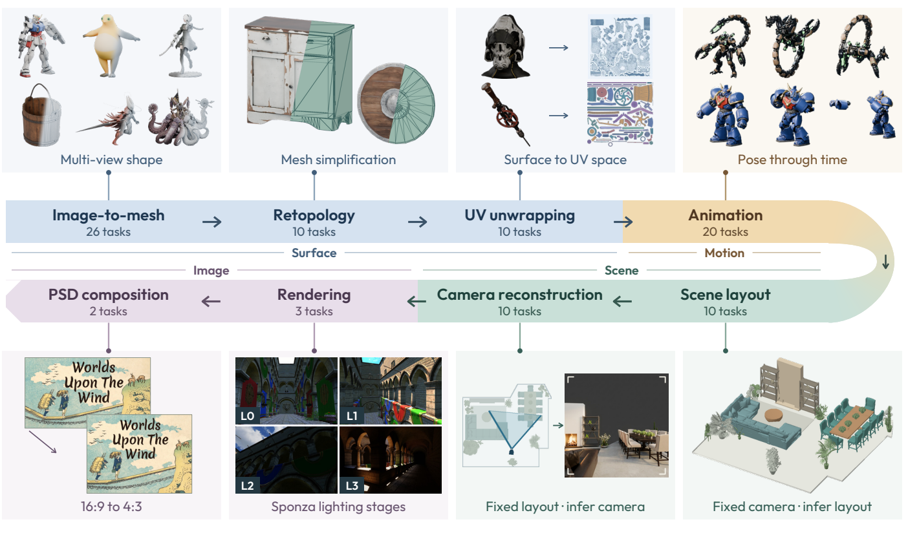

<h1 align="center">GameAtlas</h1>

<p align="center"><strong>Bringing LLM Agents Back to Basics in Visual Coding and Spatial Reasoning for Game Development</strong></p>
<p align="center">AllSpark Team</p>
<p align="center">
  <a href="https://allspark-research.github.io/GameAtlas/">Project website</a> ·
  <a href="docs/GameAtlas.pdf">Paper</a> ·
  <a href="https://huggingface.co/datasets/AllSpark-Research/GameAtlas">Dataset</a> ·
  <a href="https://allspark-research.github.io/GameAtlas/#leaderboard">Leaderboard</a> ·
  <a href="#quickstart">Quickstart</a>
</p>

How well can a coding agent infer shape, motion and spatial relationships from visual references and reproduce them through code? **GameAtlas** measures these capabilities with **91 tasks across eight disciplines** of professional game development. Each task isolates a production decision and evaluates the delivered artifact with expert-defined, executable checks. Agents can inspect their work, request feedback and revise it before final evaluation. Scoring requires no LLM judge.

[](https://allspark-research.github.io/GameAtlas/#showcase)

## Task collection

Across the eight disciplines, agents infer shape from images, preserve geometry under changes of representation, and recover motion, scene structure and appearance from visual references.

| Discipline | Tasks | What the agent must do |
| --- | ---: | --- |
| Image-to-mesh reconstruction | 26 | Infer a 3D shape that agrees with the object’s silhouette and structure across reference views. |
| Retopology | 10 | Simplify a mesh to a triangle budget while preserving its silhouette, thin structures and boundaries. |
| UV unwrapping | 10 | Map a fixed 3D surface into a 2D texture atlas while limiting distortion and keeping UV islands separated. |
| Character animation | 20 | Reproduce the reference motion on a rigged character, matching poses, timing and contacts. |
| Scene layout | 10 | With the camera fixed, recover the object identities, counts, positions and orientations from a reference image. |
| Camera reconstruction | 10 | With the scene fixed, infer the camera pose and field of view that reproduce the reference framing. |
| Rendering | 3 | Implement or repair a renderer to reproduce the lighting and appearance in the target views. |
| PSD composition | 2 | Adapt layered artwork to a new aspect ratio while preserving readability, spatial relationships and editable layers. |

[Interactive task examples](https://allspark-research.github.io/GameAtlas/#workflow-title) · [Task packages and file formats](docs/dataset.md)

## Evaluation and results

GameAtlas records the first submission and the final delivery. During a run, the agent can call `submit_score` for task-specific feedback within its submission budget. The verifier grades the files the agent leaves at delivery. Among the 17 evaluated models, GPT-6-Astra achieves the highest final weighted score, improving from **55.95 to 69.10** out of 100. The [leaderboard](https://allspark-research.github.io/GameAtlas/#leaderboard) includes results by discipline. The [evaluation protocol](docs/evaluation.md) explains how online feedback and final grading work.

## Quickstart

### Run one task

Use Python 3.11+, Docker with Linux/AMD64 support and a vision-capable model endpoint. Allocate about 16 GiB to Docker for one concurrent task. The commands below fetch the harness and one task. While the repositories are private, use a GitHub account with access to clone the repository and run `hf auth login` with read access to the GameAtlas dataset before downloading.

```bash
git clone --depth 1 --filter=blob:none --sparse https://github.com/AllSpark-Research/GameAtlas.git
cd GameAtlas
git sparse-checkout set gameatlasharness docs/assets
python3 -m pip install huggingface_hub
python3 -m gameatlasharness.download --task gameatlas_091
cp gameatlasharness/model.example.json model.local.json
```

Task 091 asks the agent to adapt layered artwork from 16:9 to 4:3 and deliver both an editable PSD and a matching PNG. Set `model` and `base_url` in `model.local.json` and supply the endpoint credential through `OPENAI_API_KEY`. Prepare the task environment, then start the run.

```bash
python3 -m gameatlasharness.run --config model.local.json --prepare
python3 -m gameatlasharness.run --config model.local.json --output runs/first-task
```

Read the final score and status in `runs/first-task/gameatlas_091/attempt-001/result.json`. The [runner guide](gameatlasharness/QUICKSTART.md) covers configuration and resuming a run. The [dataset card](https://huggingface.co/datasets/AllSpark-Research/GameAtlas#try-a-verifier-with-docker) includes a verifier-only example you can run without a model endpoint.

### Run all 91 tasks

Use the same checkout and model settings. Remove the `"tasks": ["gameatlas_091"]` field from `model.local.json` to enable task discovery. From the repository root, download the full collection, prepare its environments and run one pass over all 91 tasks.

```bash
python3 -m gameatlasharness.download
python3 -m gameatlasharness.run --config model.local.json --prepare
python3 -m gameatlasharness.run --config model.local.json --output runs/all-91
```

Scores are written to `runs/all-91/<task-id>/attempt-001/result.json`. For independent repeats, use a fresh output directory for each pass.

The [website source](docs/site/) includes the interactive showcases and leaderboard.
